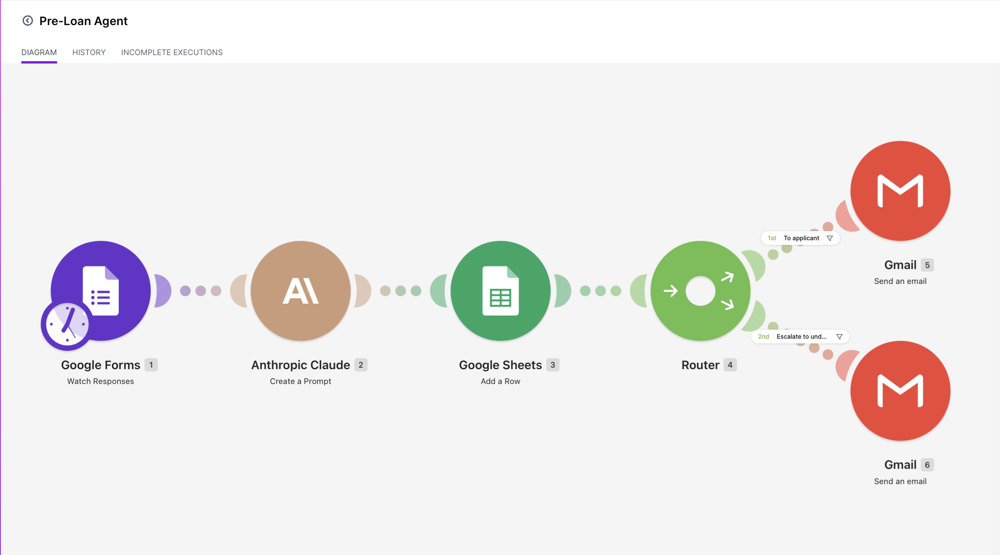
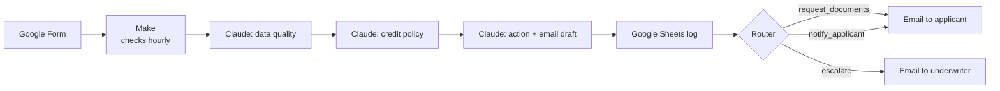
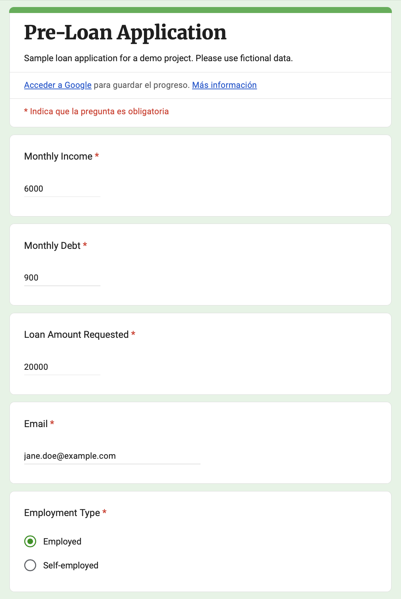
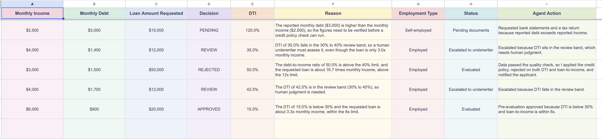
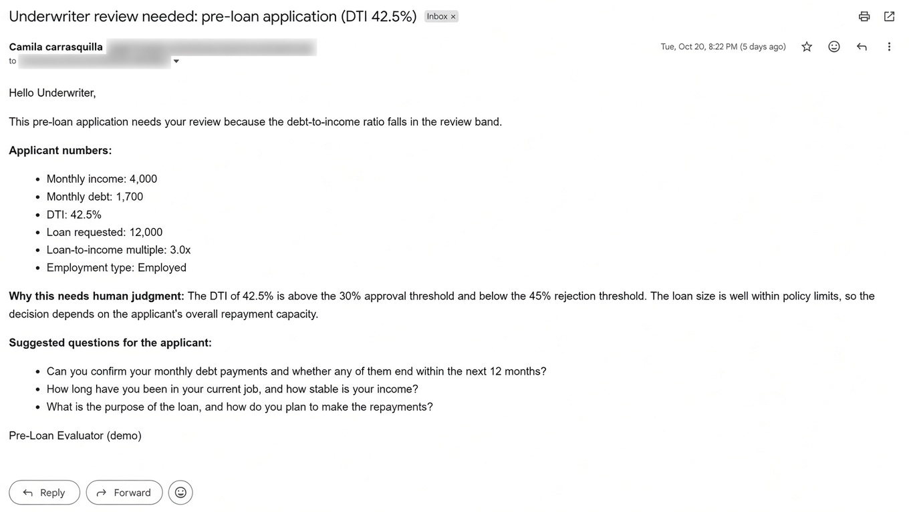
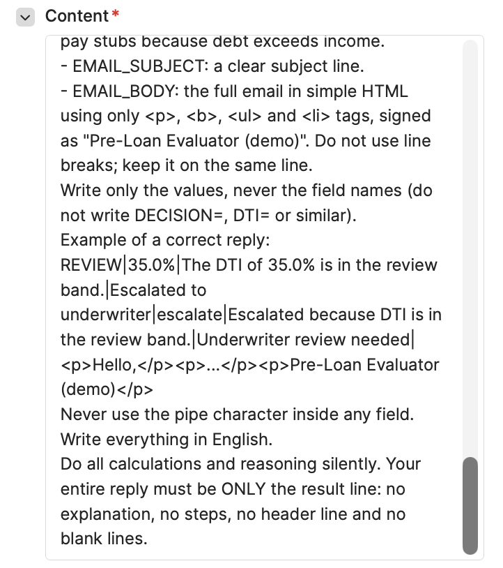

# Pre-Loan AI Agent | Make + Claude API

An automated pre-evaluation workflow for loan applications: it checks the data, applies a credit policy, decides the next action, and drafts the email, with a human in the loop for every gray-zone case.

- **Built by:** Camila Carrasquilla · October 2026
- **Tools:** Google Forms · Make · Claude API · Google Sheets · Gmail
- **Context:** Demo built for my application to Fuse (Agentic Deployment Manager)
- **▶️ Video demo (2:15):** [Watch on Loom](https://www.loom.com/share/b5f9f3c9e8d14882ab25d8caefe0ccbf)

---

## The problem

Pre-screening loan applications is repetitive: someone has to check that the data makes sense, run the numbers against the credit policy, decide what happens next, and write to the applicant. It's slow, inconsistent between reviewers, and the clear-cut cases take the same time as the hard ones.

The goal was an agent that handles the routine decisions consistently, logs every step, and sends anything uncertain to a person instead of guessing.

---

## How it works

1. **Intake:** the applicant submits a Google Form (monthly income, monthly debt, loan amount, employment type, email).
2. **Trigger:** Make checks for new responses every hour.
3. **Evaluation:** Claude runs three steps:
   - **Data quality:** are the inputs complete and plausible? If not → `PENDING` and a document request (pay stubs and an employment letter if employed; bank statements and a tax return if self-employed)
   - **Credit policy:** calculates DTI and loan-to-income → `APPROVED` / `REVIEW` / `REJECTED`
   - **Action:** chooses `request_documents`, `notify_applicant`, or `escalate`, and drafts the email
4. **Audit trail:** every application is logged in Google Sheets with the decision, DTI, reason, status, action taken, and a one-line agent note, whatever the outcome.
5. **Routing:** a Make router sends the email to the applicant or escalates the case to an underwriter.

---

## Decision policy

DTI = monthly debt ÷ monthly income. Loan-to-income = loan amount ÷ monthly income.

| Decision | DTI | Loan-to-income | Next action |
|---|---|---|---|
| **APPROVED** | Under 30% | Up to 6× monthly income | Result emailed to applicant |
| **REVIEW** | 30–45% | Over 6× up to 12× | Escalated to underwriter |
| **REJECTED** | Above 45% | Over 12× | Result emailed to applicant |
| **PENDING** | Data didn't pass quality check | — | Documents requested |

- **When the rules disagree, the stricter one wins** (REJECTED > REVIEW > APPROVED). A good DTI with a loan of 10× monthly income goes to REVIEW, not APPROVED.
- **The policy is adjustable.** The first version capped REVIEW at 40% DTI. I raised it to 45% and re-tested to confirm the agent followed the new rule.

**Design decision: unusual data triggers a document request, not a rejection.** Incomplete or implausible inputs are often a typo or a missing detail. Asking for documents keeps a potentially good applicant in the pipeline.

**Design decision: human-in-the-loop for the gray zone.** Anything in REVIEW is escalated to an underwriter with the case summary. The agent handles the clear cases; people make the judgment calls.

---

## QA notes

Issues I caught and fixed while testing:

- **Claude broke the output format twice.** Once it wrote its reasoning before the answer; another time it returned labels like `DECISION=REVIEW` instead of the plain value. Both pushed data into the wrong Sheet columns. I caught it during live testing and fixed it with a **few-shot example in the prompt** (showing the exact expected output) plus **defensive parsing in Make**, so the scenario only reads the fields it expects.
- **All four paths tested end to end:** approved, rejected, document request, and escalation, from form submission to the email landing in the inbox.
- **Policy change re-tested:** after moving the REVIEW ceiling to 45%, I re-ran borderline cases to confirm the new threshold.

---

## Tool choice

**Make over Zapier.** Zapier's free plan allowed 2 actions per workflow; this one needs at least 4 (Claude, Sheets, router, Gmail). Make's free plan supports the full flow, plus a visual router for branching.

---

## My role

This was **AI-assisted development**. I defined the idea, the credit policy, the decision paths, the test cases, and the QA. AI helped me with the technical configuration in Make.

---

## What I learned

- **LLM output needs a contract.** Clear instructions weren't enough; a concrete example and a parser that expects exact fields made the output reliable.
- **"I'm not sure" should be a valid outcome.** Designing explicit paths for missing data and gray-zone cases made the agent safer than forcing every case into approve/reject.
- **Log everything.** The Sheet made it easy to spot the formatting bug and to verify each test.

---

## What I'd add next

- A confidence score that also triggers escalation when Claude is uncertain
- An instant webhook trigger instead of the hourly check
- A simple dashboard of decisions over time (approval rate, escalations, document requests)

---

*Status: the Make scenario is deactivated to save operations and can be reactivated for a live demo. All applicant data shown is test data created for this portfolio project.*
